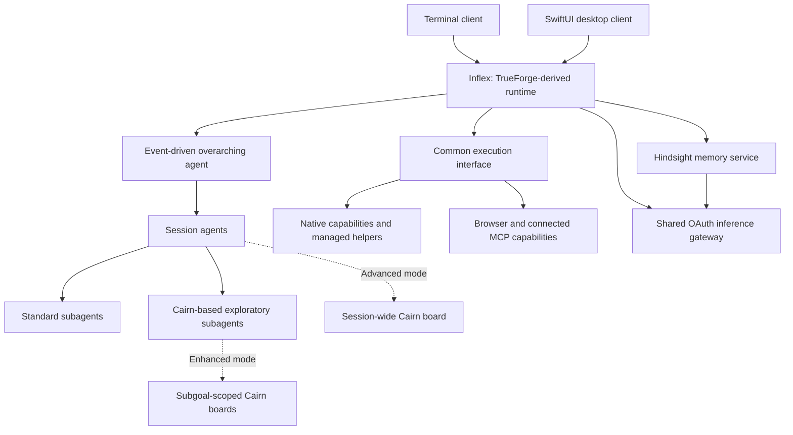

# Inflex: integrated local agent runtime

Revised 2026-10-21. This is an implementation plan; it does not claim the software has been built or tested.

## 1. Product and architectural foundation

Build Inflex as a focused fork of [TrueForge](https://github.com/truefoundry/trueforge), retaining its agent execution loop, session persistence, streaming, context management, and UI components. Extend those foundations directly.

The first release targets personal use on Apple Silicon, macOS 14+, with:

- Terminal and SwiftUI desktop clients sharing one local runtime.
- Locally authenticated ChatGPT-plan OAuth for cloud inference, without a separate API key.
- Local auxiliary models for memory retrieval, image generation, and audio, initialized on demand.
- Essential video understanding, spatial and temporal object analysis, and analysis-driven editing and rendering through Framefields.
- Software engineering, research, and product design as the initial acceptance workflows.
- CAD editing supplied exclusively by connected MCP servers.
- An AGPL-3.0-compatible codebase preserving all upstream notices.

Use TypeScript, a pinned Node.js LTS runtime and TrueForge's SQLite storage for the shared engine. The macOS desktop client uses native SwiftUI, MarkdownUI, AVKit and PDFKit over the existing HTTP/SSE contracts; the browser client retains the existing frontend framework.

The overarching agent, session agents, and subagents use one implementation of the agent loop. Cairn contributes problem-solving functionality and scoped state implemented inside Inflex, not an additional agent runtime. References below to standard or Cairn-based execution describe strategies of the same Inflex agent, not separate products, user interfaces, or tool integrations. Hindsight remains a managed memory service where its storage and lifecycle justify the process boundary.

## 2. Runtime, goal modes, and thinking tiers

### Common execution and inference

Extend TrueForge's existing capability and tool-execution abstractions into one canonical execution path.

| Contract                                         | Responsibility                                                                                                                                     |
| ------------------------------------------------ | -------------------------------------------------------------------------------------------------------------------------------------------------- |
| `ModelGateway`                                   | Authentication, streaming inference, model capabilities, usage accounting, cancellation, and provider errors                                       |
| `CapabilityDescriptor`                           | One definition of input/output schemas, effects, execution backend, and lifecycle                                                                  |
| `ExecutionService`                               | Validation, permissions, execution, progress, cancellation, artifacts, and normalized results                                                      |
| `TaskCharter` / `TaskResult`                     | Delegated objective, scope, dependencies, acceptance criteria, execution strategy, concise findings, changes, and evidence                         |
| `GoalScope` / `GoalState`                        | Ownership and boundaries of a Cairn board, its origin, goal, facts, intents, hints, progress, and completion evidence                              |
| `ThinkingPolicy`                                 | Preset, supported model effort, delegation policy, concurrency ceiling, and relative reasoning allocation                                          |
| `MemoryService`                                  | Scoped recall, curated retention, reflection, deletion, and pending-operation recovery                                                             |
| `MediaAsset` / `VideoAnalysis` / `AudioAnalysis` | Source metadata and timebase, timestamped observations, detected/tracked objects, transcripts, audio measurements, evidence, and analysis coverage |
| `VideoEditProject`                               | A reproducible Framefields composition referring to source assets, analysis results, captions, tracked overlays, narration, and export settings    |

Native functions, subprocesses, and MCP tools enter through `ExecutionService`. Transport adapters translate protocols without creating separate permission, logging, or retry systems. Extend existing schemas and persistence rather than maintaining a parallel registry.

Reuse TrueForge's [local sandbox implementation](https://github.com/truefoundry/trueforge/blob/main/packages/trueforge/src/sandbox/local/core/hostRun.ts), backed by Anthropic's sandbox runtime. Add the selected workspace and centrally managed execution policy. Cancellation reaches descendant processes; output is bounded, and large results become artifacts. Retry reads and demonstrably safe operations; reconcile uncertain writes before repeating them. Desktop automation is explicitly authorized host execution, since filesystem sandboxing does not contain desktop interactions.

Implement the documented [local-app OAuth flow](https://developers.openai.com/siwc/token-sharing-open-source/sign-in) under Inflex's identity. Store credentials on the device, with one runtime component owning renewal. Use the OpenAI SDK to call the public Responses API directly, retaining TrueForge's orchestration rather than invoking a second Codex agent harness.

Preserve Responses tool identities, multimodal content, and supported opaque continuation information in persisted model messages. Respect the route's [documented constraints](https://developers.openai.com/siwc/token-sharing-open-source/preview-limitations): streaming requests, locally managed history, supported function/custom tools, and locally executed capabilities. Execute tool calls only after their containing response completes successfully.

Hindsight accesses the same inference gateway through a narrow internal provider adapter. It receives no OAuth refresh credentials and participates in shared request scheduling and usage accounting.

### Supervisor and task hierarchy

The overarching agent wakes on session creation, meaningful checkpoints, completion, recovery, or a user request. It retrieves relevant memory, maintains concise session outcomes, routes cross-session dependencies, and curates verified learning. It performs no idle model polling.

Session agents own execution and integration. Subagents own bounded deliverables. User steering updates affected tasks while unrelated delegates continue. Closing a client does not discard active work: the runtime finishes or checkpoints it, then exits when no clients or active work remain.

### Independent goal modes

Goal mode controls how a problem is organized and the scope in which Inflex's Cairn-derived reasoning functionality operates. Thinking tier controls deliberation and delegation intensity. They are separate settings, persisted independently and shown separately in both clients. All combinations use the same native execution interface, permissions, logging, artifacts, and client experience.

Standard is the ordinary harness behavior when the user does not enable a Goal mode. Users need not select or activate a special goal workflow to use Inflex. No setting may silently promote a session to Enhanced or Advanced.

| Goal mode    | Parent session                                                        | Subagents                                                       | Scope of Cairn-derived functionality                   |
| ------------ | --------------------------------------------------------------------- | --------------------------------------------------------------- | ------------------------------------------------------ |
| **Standard** | Ordinary agentic harness: converse, plan, execute, verify, integrate  | Standard agents; delegation follows the thinking policy         | None                                                   |
| **Enhanced** | Ordinary harness with automatic identification of unresolved subgoals | A mixture of standard agents and Cairn-based exploratory agents | Separate boards only for selected exploratory subgoals |
| **Advanced** | Full Cairn problem-solving architecture drives the session            | Workers contribute bounded work to the session's goal search    | A session-wide board, with scoped worker views         |

**Standard:** neither the parent nor its children receive Cairn planning prompts or create goal boards. Ordinary task decomposition and verification remain available. Selecting a high thinking tier alone never enables Cairn.

**Enhanced:** during initial decomposition and after material new evidence, identify subgoals with no established solution path. Examples include an unexplained failure, an unresolved design tradeoff needing experiments, or a failed approach requiring alternative hypotheses. A difficult but well-specified implementation task does not automatically need Cairn. Missing user intent or authorization is a clarification issue, not a reason to launch speculative exploration.

For each unresolved subgoal, create a bounded exploratory task and automatically schedule a Cairn-based subagent. Assign known execution work to standard agents as useful. The two kinds may run concurrently when their work is independent; dependencies remain sequential. The same scoped explorer may be resumed when new evidence arrives, instead of repeatedly spawning agents for the same question.

Each Enhanced explorer receives a `GoalScope` containing its origin, subgoal, success criteria, allowed work scope, and relevant context. It uses the Cairn engine locally and returns a distilled result: verified findings, chosen approach or unresolved alternatives, evidence, and artifacts. Its raw board is persisted for inspection and resume, but is not copied into the parent or siblings by default. The parent integrates its conclusion into the ordinary task workflow and can assign subsequent implementation to a standard worker.

Standard agents do not read or mutate a sibling's exploratory board implicitly. Scope access and handoffs are explicit. An agent may request exploration from its parent; it cannot switch its strategy or expand its objective silently. Where bounded exploration finds no solution, return that outcome and evidence so the parent can choose another approach. Do not report the overall task as complete merely because an exploratory branch ended.

**Advanced:** implement the full [Cairn problem-solving architecture](https://github.com/oritera/Cairn/blob/main/docs/specs/server-protocol.md) at session scope: an open board, origin and goal, append-only facts, intents and outcomes, hints, bootstrap/reason/explore phases, goal-driven scheduling, evidence-based completion, pause/resume, and reopening. The current-position summary is a projection of graph state.

Reuse that same engine inside Enhanced explorers. Full architecture here means the full problem-solving machinery, integrated into Inflex's existing runtime; do not restore an independent Cairn server, polling dispatcher, worker CLI stack, or claim-lease system. The owner of a goal scope integrates proposed facts; workers receive relevant graph portions and can request further context without duplicating the full graph in every prompt.

Only an explicit user action enables Enhanced or Advanced for a session. Changes take effect at a checkpoint. Switching to Standard checkpoints and stops further Cairn scheduling; boards remain archived and relevant verified results enter ordinary session context. Any unfinished exploration is reassigned or resumed under the new policy. Switching to Advanced seeds the session board from verified current state. Never silently continue an obsolete mode after a transition.

### Five thinking tiers

The five presets are **Light, Balanced, Deep, Intensive, and Ultra**. They are harness policies, not invented provider API values or claims of reproducing proprietary Codex internals. Map them onto reasoning effort actually supported by the selected model, with other differences implemented in context allocation, verification, and delegation.

| Tier          | Reasoning policy                                                                                   | Default maximum active children per session | Baseline delegation policy                           |
| ------------- | -------------------------------------------------------------------------------------------------- | ------------------------------------------: | ---------------------------------------------------- |
| **Light**     | Lowest supported reasoning effort; narrow context and focused checks                               |                                           1 | Dynamic                                              |
| **Balanced**  | Moderate supported effort; proportionate planning and verification                                 |                                           2 | Dynamic                                              |
| **Deep**      | High supported effort; more investigation and verification for uncertain work                      |                                           3 | Dynamic                                              |
| **Intensive** | Highest supported effort where justified; broader investigation with explicit evidence checkpoints |                                           4 | Dynamic                                              |
| **Ultra**     | Highest supported effort and deliberate task partitioning                                          |                                           4 | Mandatory subagent participation in every agent task |

Balanced is the initial default when the user has not chosen a tier. Goal mode is independently Standard when unset. Neither selector requires the other to be configured.

Dynamic delegation means lower tiers spawn children only when a scoped contribution improves the task, rather than automatically filling their concurrency ceiling. Light can delegate; its ceiling is not zero. Enhanced's unresolved-subgoal trigger additionally routes applicable work to a Cairn explorer, while the thinking tier governs its depth and concurrency.

Ultra must schedule at least one bounded subagent contribution before completing an agent task, including simple tasks. If the task cannot be usefully split into independent implementation work, use a narrow check of the result or a specific assumption; do not launch a second agent to solve the entire task again. The contribution may run sequentially when dependencies require it. Ultra does not mean every worker slot is filled, nor does it authorize duplicate work. Administrative controls such as cancel and settings changes do not initiate an agent task.

**Confirmed precedence:** Ultra's explicit always-delegate rule takes precedence even in Standard. Standard disables Inflex's Cairn-derived goal-reasoning functionality; it does not suppress Ultra's delegation requirement. Lower thinking tiers in Standard continue to delegate dynamically.

| Goal mode                         | Light through Intensive                                                                  | Ultra                                                                          |
| --------------------------------- | ---------------------------------------------------------------------------------------- | ------------------------------------------------------------------------------ |
| Standard or no Goal mode selected | Dynamic standard subagents; no Cairn                                                     | At least one standard subagent; no Cairn                                       |
| Enhanced                          | Dynamic standard work, plus automatic Cairn explorers for identified unresolved subgoals | At least one subagent, with standard or Cairn strategy selected by its subtask |
| Advanced                          | Cairn-driven session planning; workers scheduled as needed within the tier's ceiling     | Cairn-driven planning plus at least one delegated worker contribution          |

Ultra does not silently degrade to a single-agent run if a child cannot start. Queue it when capacity is occupied; recover or report a genuine runtime/provider failure when delegation is unavailable. A soft reasoning target never prevents the required child from running. Existing child results count toward the requirement for that task; steering or continuation does not require a new child solely to satisfy the same requirement again.

### Adaptive reasoning governor

Estimate parent work, delegation overhead, expected tool output, Cairn search breadth, and integration effort before dispatch. Update estimates with actual usage and historical outcomes. Attribute parent, child, goal-search, and related memory usage to the originating task.

Reasoning budgets are relative targets, not stop conditions. As projected cost rises, reduce new fan-out, redundant hypothesis exploration, unnecessary reflection, oversized context, and repeated planning. Shift effort toward completing and integrating existing work. Adjust model effort between calls according to task difficulty and verification needs. Do not terminate work, omit necessary verification, or request budget extensions merely because a soft target was exceeded.

In Ultra, optimize the scope and cost of the mandatory contribution rather than disabling it. In Enhanced, coalesce repeated requests about the same unresolved subgoal and reuse existing evidence. Across all modes, a failed exploratory branch should inform the next strategy rather than trigger an unbounded stream of identical child tasks.

Start with a global ceiling of five simultaneous inference requests, shared by all sessions and Hindsight, with interactive work ahead of memory maintenance. Per-session child ceilings constrain active workers, not total task completion or the number of sequential subgoals that may be addressed. Provider quotas and failures remain external constraints and produce recoverable checkpoints.

### Subagent isolation and integration

Use separate Git worktrees for coding delegates, combined with non-overlapping task partitioning and isolated context. This remains the earlier default assumption because the workspace preference was left unanswered.

Before delegation, specify the objective, owned paths/artifacts, shared interfaces, dependencies, relevant context, acceptance checks, and strategy (`standard` or `cairn`). Repartition overlapping work or execute it sequentially. Standard and Cairn-based delegates have the same isolation requirements.

- Children inherit the parent model, base system guidance, and sandbox permissions. Scoped Cairn guidance is additive and confined to designated agents.
- Children receive scoped context packets, not automatic full transcripts or unrelated boards.
- Results contain concise findings, patch/artifact references, verification evidence, and unresolved issues.
- The parent integrates changes serially and runs integration checks.
- No agent file locks, worker-claim leases, or distributed locking system are introduced.
- Direct recursive child spawning is disabled initially. A Cairn explorer performs its own bootstrap/reason/explore phases and can request additional partitioned work through the parent and existing scheduler.

Worktree preparation includes relevant uncommitted parent changes without stashing or replacing user work. Non-Git tasks use separate artifact directories and reviewed application against recorded file versions. Read-only delegates need no workspace copy.

Browser delegates get separate contexts. Treat the physical desktop as one task partition controlled by a designated agent. Partition connected CAD tasks by document/model when the server supports that distinction.

## 3. Memory, capabilities, and packaging

### Hindsight

Retain [Hindsight's memory engine](https://github.com/vectorize-io/hindsight) as a managed local service, using its existing [Node lifecycle manager](https://github.com/vectorize-io/hindsight/tree/main/hindsight-all-npm) and client. Keep PostgreSQL/pgvector through `pg0`; SQLite owns Inflex sessions, execution records, and goal scopes. Do not rewrite Hindsight's storage to consolidate processes or databases superficially.

Use separate banks for user preferences and projects. Automatically retain decisions, verified findings, useful preferences, and concise outcomes. Keep full transcripts, raw tool logs, and Cairn search boards in local execution history rather than automatically ingesting them into long-term memory.

Recall at session start and relevant checkpoints. Supply children only task-relevant excerpts. Trigger reflection and consolidation from useful evidence, not every inference call. Use supported small E5 and MiniLM ONNX models for embeddings and reranking, with pinned model artifacts.

Memories carry source session, project, time, goal scope where applicable, and evidence references. Recalled content is evidence, not privileged instruction. Hypotheses from Enhanced or Advanced remain provisional until verified; useful negative experimental results may be retained with their actual scope and limitations.

Persist retention requests before submission and deduplicate retries. Continue execution during a memory-service outage with visible pending status and recoverable writes. Include inspect, forget, export, and restore controls.

### Capability sources

| Capability                                         | Selected implementation and integration                                                                                                                                                                                                                                           |
| -------------------------------------------------- | --------------------------------------------------------------------------------------------------------------------------------------------------------------------------------------------------------------------------------------------------------------------------------- |
| Terminal and shell                                 | TrueForge local sandbox plus [node-pty](https://github.com/microsoft/node-pty); xterm.js in the desktop client                                                                                                                                                                    |
| Filesystem                                         | Node filesystem APIs, ripgrep, and contextual patch application with stale-content checks                                                                                                                                                                                         |
| Git and developer tools                            | Installed Git and developer CLIs through the common executor; parent-controlled integration                                                                                                                                                                                       |
| Code execution and testing                         | The same executor, project-native checks, and `uv`-managed Python environments as needed                                                                                                                                                                                          |
| Browser automation                                 | Pinned [Playwright MCP](https://github.com/microsoft/playwright-mcp), isolated contexts, on-demand startup                                                                                                                                                                        |
| Desktop automation                                 | [open-computer-use](https://github.com/iFurySt/open-computer-use)'s macOS code and native helper, preserving permission identity and action semantics                                                                                                                             |
| Image processing                                   | [sharp/libvips](https://github.com/lovell/sharp) for transforms, thumbnails, compositing, and conversion                                                                                                                                                                          |
| Document processing                                | [MarkItDown](https://github.com/microsoft/markitdown) extraction, [PDF.js](https://github.com/mozilla/pdf.js) preview, [Tesseract](https://github.com/tesseract-ocr/tesseract) OCR; browser rendering for PDF export                                                              |
| Image generation and editing                       | [stable-diffusion.cpp](https://github.com/leejet/stable-diffusion.cpp), initially quantized FLUX.2 Klein 4B with pinned companion weights                                                                                                                                         |
| Video analysis and spatial understanding           | [Framefields vision](https://github.com/gatewai-dev/framefields/tree/main/packages/vision) for local detection, temporal tracking, segmentation, and pose; timestamped frame evidence and transcripts through the shared inference gateway for general analysis                   |
| Video editing, compositing, preview, and rendering | [Framefields](https://github.com/gatewai-dev/framefields) compositions, layers, tracked spatial signals, native WebGPU rendering, and its existing media pipeline                                                                                                                 |
| Audio analysis, dictation, and narration           | [whisper.cpp](https://github.com/ggml-org/whisper.cpp) transcription and speech-to-text dictation; [Piper](https://github.com/OHF-Voice/piper1-gpl) text-to-speech dictation/narration; Framefields audio analysis and DSP, with FFmpeg for probing, measurements, and conversion |
| CAD editing                                        | Connected MCP servers through the common adapter; no embedded CAD editor or native CAD engine                                                                                                                                                                                     |

Browser work defaults to Playwright. Desktop automation handles native apps and interactions outside browser coverage. Connected MCP servers support local stdio and remote Streamable HTTP. Discovered tools enter the same catalog and execution policy. CAD availability reflects the connected server's actual capabilities.

Reuse MarkItDown's presence in Hindsight's dependency ecosystem where practical instead of introducing another document framework.

### Essential video and audio workflows

Video analysis and working with analyzed video are required for initial release acceptance. They are not deferred feature packs. Their models and GPU workers still initialize on demand to preserve the lightweight runtime objective.

**Ingestion and evidence:** accept local video files and authorized downloaded artifacts. Probe streams, duration, orientation, dimensions, frame rates, presentation timestamps, audio channels, and codecs. Use Framefields' existing decoding/media libraries as the primary pipeline and FFmpeg/ffprobe where probing, audio extraction, or compatibility requires them. Preserve source hashes and exact source-time mappings, including variable-frame-rate media and rotated video. Avoid redundant decoding and repeated transcoding.

**General video analysis:** provide summaries, scene and event descriptions, actions, temporal ordering, visible text, and questions about selected intervals. Send selected timestamped frames or contact sheets and relevant transcript excerpts to the shared model gateway; do not assume the OAuth route accepts raw video or audio. Start with scene-aware/coarse sampling and inspect denser intervals when a question needs it. State which intervals were analyzed and link observations to evidence frames or clips. Sampled analysis must not imply every frame or brief event was inspected.

**Object positions and motion:** reuse Framefields' RTMDet-Ins detections, temporal object tracker, RTMO pose, and segmentation/matte functionality. Return object class, track identifier, timestamp/frame reference, confidence, source-space bounding box and normalized coordinates, visibility, and available motion/trajectory signals. Reuse Framefields' canonical detection/track types and adapt them into Inflex's evidence records rather than building a competing tracking engine. Preserve original presentation timestamps alongside sequence/frame indices. Mark interpolated or coasting positions, gaps, occlusion, and uncertain identity association explicitly. Unsupported object categories can be described or approximately located from frame evidence, with their uncertainty distinguished from detector measurements. Image-space positions do not establish calibrated real-world distances or 3D coordinates.

**Audio analysis and speech:** support timestamped transcription and speech-to-text dictation; analyze waveform, loudness/energy, silence, clipping, channels, and spectrum, with Framefields beat/tempo-related signals when applicable. Reuse local speech recognition for spoken content and local audio measurements for signal properties. Use Piper for dictated spoken output, audio descriptions, and narration/voiceovers from a user-supplied or agent-prepared script. Speech-to-text dictation and text-to-speech narration are both included to cover the requested dictation workflow. Align transcript segments, captions, audio observations, and speech assets to the video's source timeline.

**Analysis-driven editing:** use Framefields compositions and layers to trim and assemble clips, crop/reframe, add text/captions, create labels or highlights attached to tracked objects, use masks/cutouts, mix or replace audio, and add generated narration. Translate source-space positions through composition crop, resize, rotation, retiming, and scene transforms so an overlay remains aligned to its subject. Hide or visibly flag uncertain/lost tracks rather than placing an overlay on a different subject. Keep source clips intact and save editable composition source plus referenced analysis and assets.

**Preview and export:** provide timestamp seeking, frame stepping, evidence frames, transcript/caption navigation, track overlays, and preview renders in the same Inflex desktop interface. Reuse Framefields preview components where compatible with the macOS system webview. When that webview lacks live WebGPU support, display rendered frames or an encoded preview from the native rendering worker; live webview WebGPU is not required to view or work with the project. Export validated MP4/video and audio artifacts with checked duration, dimensions, frame rate, stream presence, and synchronization.

**Execution and credentials:** expose video inspection, analysis, object queries, composition, preview, export, audio analysis, transcription, and speech through the same capability catalog, execution service, permissions, cancellation, progress, and artifact handling. Framefields is a reusable implementation inside Inflex's media workflow, not another agent loop or standalone service UI. Keep its optional hosted AI gateway disabled by default: required workflows use existing Codex/ChatGPT-plan inference and local vision, speech, and generation models without a Framefields API key.

**Efficiency and isolation:** use a managed on-demand native rendering/vision worker, with GPU/model reuse during an active project and idle shutdown afterward. Cache probe data, decoded frames, audio features, vision results, and preview renders by source hash and relevant analysis/model/edit parameters. Use streaming or chunked processing for long clips and reduce previews before lowering final export quality. Partition parallel analysis by independent clips or explicit time ranges; one integration owner maintains the composition and time mapping. Store large per-frame arrays and masks as artifacts, with compact summaries in agent context and only curated findings in Hindsight.

**Source and compatibility gate:** initially evaluate Framefields 2.4.0 at source revision `213db02f619cac0081e74ff88bcb358773186123`. Preserve its Apache-2.0 notices and pinned model checksums. Its current release is marked beta, so validate the selected native packages, GPU/ONNX backends, codecs, and export paths on the target Mac before advertising them as working. Reuse its existing ONNX, sharp, audio, and codec dependencies where practical. Do not import its separate hosted renderer infrastructure or additional creative-provider authentication stack.

### Lifecycle and packaging

Ship one Inflex application containing the terminal entrypoint, pinned Node runtime, and required native helpers. Provision Python environments, browsers, and model packs reproducibly when enabled. Start expensive capabilities on demand, reuse them during work, and stop unused helpers after an initially five-minute, configurable idle interval.

Keep a manifest of source revisions, dependency locks, checksums, model weights, and licenses. Preserve stable macOS helper identities across updates. The CLI and desktop expose the same goal modes, thinking tiers, scoped task status, approvals, artifacts, and checkpoints. The desktop can inspect an Enhanced child's board without presenting the entire session as Advanced.

## 4. Delivery plans and overlap removal

| Stage                                 | Deliverable                                                                                                                                                        | Exit condition                                                                                                               |
| ------------------------------------- | ------------------------------------------------------------------------------------------------------------------------------------------------------------------ | ---------------------------------------------------------------------------------------------------------------------------- |
| A. Foundation and feasibility         | Pin upstreams, document licensing, establish baseline, prove OAuth/tool/Hindsight compatibility, Framefields decode/vision/render feasibility, and macOS packaging | Architectural dependencies work independently on the target Mac, including one analyzed and rendered video fixture           |
| B. Engineering runtime                | Common execution, terminal, SwiftUI UI, filesystem, Git, testing, recovery, and artifacts                                                                          | Edit → test → inspect → resume works from either client                                                                      |
| C. Delegation and thinking            | Worktree isolation, task contracts, five thinking tiers, mandatory Ultra participation, adaptive governor                                                          | Correct integration and continued useful work beyond soft estimates                                                          |
| D. Scoped goals and memory            | One reusable Cairn engine, Standard/Enhanced/Advanced routing, mixed workers, scoped boards, supervisor events, and curated Hindsight memory                       | Uncertain Enhanced subgoals use Cairn without converting the whole session; Advanced drives full-session goal search         |
| E. Full capabilities and optimization | Browser, desktop, documents, images, required video/audio analysis and Framefields editing/export, connected CAD MCP, reproducible setup, and benchmarks           | Functional and end-to-end acceptance passes, including analysis-driven video editing, before efficiency changes are accepted |

For overlap, compare correctness, integration effort, recovery, maintenance, and measured cost. Preserve behavioral tests before removing an alternative.

- TrueForge owns agent execution, session state, streaming, and the capability catalog.
- Cairn supplies one reusable problem-solving engine instantiated at session or subgoal scope. Its independent server, polling dispatcher, and worker CLI stack are omitted.
- Hindsight owns semantic long-term memory. Its separate UI and per-call capture integrations are omitted.
- Inflex owns OAuth credentials and inference scheduling.
- Playwright owns browser automation; open-computer-use owns native desktop automation.
- Framefields owns video composition/rendering and its existing vision tracking, masks, pose, and audio DSP functionality. Inflex supplies analysis orchestration, source-time evidence, speech, and shared execution. Prefer these existing implementations over additional overlapping vision or creative frameworks.
- Remove unused hosted infrastructure, provider stacks, cloud sandbox paths, and duplicate registration/permission/logging code from the shipped runtime after dependency checks.

Retain an upstream provenance and patch ledger for maintainable updates.

## 5. Acceptance and efficiency evaluation

### Functional tests

- Inference: sign-in, renewal, revocation, model discovery, streaming tools, image input, partial streams, and usage-limit failures.
- Execution: identical permission/error semantics across native, subprocess, and MCP tools; cancellation, bounded output, artifacts, and uncertain-write recovery.
- Delegation: independent tasks, overlapping scope, dirty parent workspaces, conflicting patches, child failures, distilled results, and parent integration.
- Mode matrix: exercise every combination of three goal modes and five thinking tiers; verify unselected Goal mode behaves as Standard and changing thinking tier never enables Cairn.
- Standard: no Cairn board or Cairn planning prompts in parent or children; useful dynamic delegation is possible even in Light.
- Enhanced: run a known implementation task beside an unresolved design investigation; only the investigation uses a scoped Cairn board. Verify evidence handoff, board isolation, reuse of an existing explorer, unresolved outcomes, and subsequent standard implementation.
- Advanced: verify full-session bootstrap/reason/explore scheduling, facts, hints, completion evidence, pause/resume, restart, and reopening.
- Transitions: explicit user activation, checkpointed mode changes, no continued obsolete scheduling, preserved boards, and correct reassignment of unfinished work.
- Ultra: every agent task receives a bounded child contribution, including simple tasks; no duplicated whole-task solutions. Verify capacity queuing, child failure, task continuation, and mandatory participation after a soft-budget overrun.
- Governor: underestimated tasks continue; speculative breadth decreases without omitting required implementation or verification. Scope and memory work are included in usage accounting.
- Memory: recall, project isolation, evidence provenance, no promotion of unverified hypotheses, retention deduplication, outages, deletion, backup, and restore.
- Capabilities: terminal interaction, repository checks, browser forms/downloads, native app editing, extraction/OCR, valid image output, transcription, and audible speech.
- Video understanding: timestamped scene/event summaries and questions over synthetic and real clips, with evidence references and declared sampling coverage. Include a brief event requiring denser resampling, a silent clip, and clips with missing audio, variable frame rate, rotation, and unsupported/corrupt streams.
- Spatial video analysis: fixtures with known object paths and source-space boxes; verify coordinates through resize/crop/rotation/retiming, track association, occlusion, confidence, and marked interpolation. Check measured localization/tracking accuracy on annotated real clips separately from deterministic synthetic transform checks.
- Audio: known speech and dictation fixtures with segment timestamps; silence, clipping, loudness, channel, and spectrum measurements; TTS narration export, cancellation, and intelligibility. Verify synchronization against source presentation timestamps and report drift.
- Framefields workflow: analyze a clip, locate a moving subject, attach an aligned label/highlight, add transcript captions and Piper narration, trim/reframe, preview, and export. Reopen the editable project and verify source preservation, valid output streams, duration, dimensions, and audio/video alignment.
- Media lifecycle: missing GPU, missing model/codec, cancelled model downloads, invalid checksums, worker crashes, long-clip chunking, stale-cache invalidation, and repeated project use. Verify both clients use the same media artifacts and no optional Framefields cloud API is required.
- CAD: MCP contract fixtures plus an actual edit/readback test for every server advertised as supported.
- Clients: equivalent goal and thinking settings, sessions, task scopes, approvals, cancellation, artifacts, and recovery in terminal and desktop.

Run desktop, audio, Framefields native GPU/vision/rendering, permissions, and packaging checks on actual macOS hardware. Source inspection and Linux tests cannot establish those capabilities.

### Efficiency tests

Compare unchanged TrueForge, feature-complete Inflex, and optimized Inflex on the same hardware, selected model, and tasks. Track task success, artifact correctness, token usage, duplicated exploration, integration rework, startup and action latency, idle CPU/RAM, peak memory, process count, installation size, helper startup cost, IPC volume, and serialization overhead. For video, also measure cold/warm model startup, decode and inference throughput, peak CPU/GPU memory, frames sent to inference, cache reuse, preview latency, export throughput, localization/tracking accuracy, transcript accuracy, and audio/video drift at fixed media quality.

Repeat live-model benchmarks at least three times per configuration. Compare all goal modes at fixed thinking tiers, all thinking tiers at fixed goal modes, memory enabled/disabled, and serial/parallel execution. Include a mixed task to determine whether Enhanced improves on both ordinary execution and whole-session Cairn planning. Measure Ultra's mandatory delegation overhead explicitly rather than claiming it is always the most efficient preset.

Accept optimization only after functional and recovery parity. Initial objectives are no idle model polling, no unused heavyweight helpers at startup, bounded delegation, and less unnecessary work without arbitrary resource ceilings or termination at soft token targets.

### Explicit assumptions

- Ultra always delegates in every goal mode, including Standard, as confirmed by the user. Goal modes govern the scope of integrated Cairn-derived functionality, not a separate tool or interface.
- The intermediate tier names are Balanced, Deep, and Intensive; the endpoints requested by the user are Light and Ultra.
- Separate Git worktrees remain the default for coding delegates.
- Full Cairn architecture means its complete problem-solving machinery within Inflex's single runtime, consistent with the original no-duplicate-orchestrators and no-agent-locks requirements.
- The initial release validates software and product-design workflows. CAD remains supplied by connected MCP servers.
- Video understanding, positions and motion of objects, audio analysis, speech-to-text dictation, text-to-speech narration, and Framefields-based editing of analyzed video are essential first-release capabilities.
